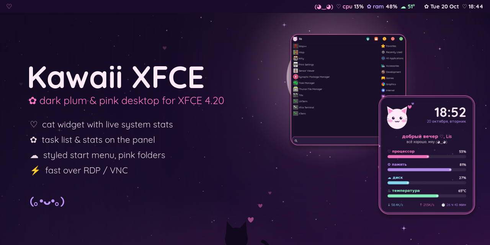
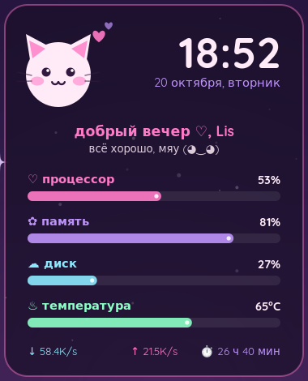
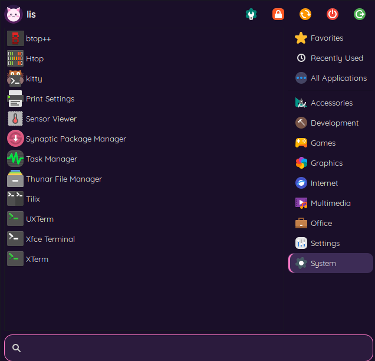

<p align="center">
  
</p>

<p align="center">
  
  
  
  
</p>

<p align="center">
  Тёмное сливово-розовое оформление для XFCE: котики, сердечки и живая статистика.<br>
  Лёгкое и быстрое, даже когда работаешь через удалённый рабочий стол <code>(｡•ᴗ•｡)♡</code>
</p>

---

## 🌸 Что внутри

<table>
  <tr>
    <td width="50%" valign="top">
      <h3>🐱 Виджет-котик</h3>
      <ul>
        <li>моргает и меняет настроение от нагрузки: спит <code>(￣ω￣)</code>, доволен <code>(◕‿◕)</code>, пыхтит <code>(＞﹏＜)</code></li>
        <li>часы, дата и приветствие по времени суток</li>
        <li>процессор, память, диск, температура, сеть, аптайм</li>
        <li>прозрачность рисуется из обоев, поэтому композитор не нужен</li>
      </ul>
    </td>
    <td width="50%" align="center"></td>
  </tr>
  <tr>
    <td width="50%" align="center"></td>
    <td width="50%" valign="top">
      <h3>✿ Меню «Пуск»</h3>
      <ul>
        <li>Whisker Menu в цветах темы</li>
        <li>скруглённый поиск с розовой рамкой</li>
        <li>розовая подсветка пунктов и категорий</li>
        <li>аватарка-котик</li>
      </ul>
    </td>
  </tr>
</table>

### 💗 И ещё

| | |
|---|---|
| 🌙 **Обои** | луна с улыбкой, котик на холме и сердечки, 2560×1440. Генератор: [`tools/make-wallpaper.py`](tools/make-wallpaper.py) |
| 📊 **Панель** | окна-«таблетки», мордочка `(◕‿◕) ♡ cpu ✿ ram ☁ °`, розовый график процессора, часы `✿ Tue 20 Oct ♡ 18:44` |
| 🔤 **Шрифты** | Quicksand для интерфейса, Fira Code Nerd Font для терминала, цветные эмодзи вместо чёрно-белых |
| 📁 **Иконки** | Papirus-Dark с розовыми папками, собирается без sudo |
| 💻 **Терминал** | xfce4-terminal в цветах темы |
| 🐈 **oneko** | котик бегает за курсором |
| ⌨️ `--keys` | сочетания как в Windows: Win, Win+D / E / L / V / R, Win+стрелки, Win+Shift+S. Раскладка us/ru по Ctrl+Space, которая сама возвращается после переподключения RDP |
| 🖥 `--vnc` | VNC только для домашней сети: TigerVNC с UTF-8 буфером обмена и TLS, x11vnc как запасной вариант |

## 🎨 Палитра

<p>
  
  
  
  
  
  
  
  
</p>

## 🚀 Установка

**1. Зависимости** (Debian 13 / Ubuntu):

```bash
sudo apt install fonts-quicksand fonts-firacode fonts-noto-color-emoji fonts-noto-cjk \
  papirus-icon-theme breeze-cursor-theme xfce4-whiskermenu-plugin xfce4-genmon-plugin \
  xfce4-cpugraph-plugin xfce4-clipman xfce4-taskmanager python3-gi python3-gi-cairo \
  python3-cairo gir1.2-gtk-3.0 oneko
```

**2. GTK-тема** [Dracula](https://github.com/dracula/gtk): распакуй её в `~/.themes/Dracula`.

**3. По желанию:** [FiraCode Nerd Font](https://github.com/ryanoasis/nerd-fonts/releases) в `~/.local/share/fonts` для иконок в терминале, и `tigervnc-scraping-server`, если нужен `--vnc`.

**4. Запуск:**

```bash
git clone https://github.com/Ducheved/kawaii-xfce.git
cd kawaii-xfce
./install.sh                  # оформление, виджет, терминал, меню
./install.sh --panel          # + пересобрать верхнюю панель (заменит текущую!)
./install.sh --panel --keys   # + сочетания клавиш и раскладка
```

> [!TIP]
> Всё, что установщик перезаписывает, сохраняется в `~/.config/kawaii-backup/<дата>/`.

## ⚙️ Настройка

- **Имя в приветствии** берётся из `$USER`. Своё можно задать в `~/.config/autostart/kawaii-widget.desktop`: `Exec=env KAWAII_NAME=Имя …/kawaii-widget.py`.
- **Место виджета** задают константы `X, Y` в начале [`kawaii-widget.py`](scripts/kawaii-widget.py).
- **VNC:** пароль хранится в `~/.vnc/passwd` (создать: `tigervncpasswd`). Интерфейс и порт задаются через `KAWAII_VNC_IFACE` / `KAWAII_VNC_PORT`.

## 📝 Заметки

<details>
<summary>Почему выключен композитор?</summary>

Через RDP и VNC это самое заметное ускорение. Тени и прозрачность без видеокарты отрисовываются медленно, а иногда превращаются в чёрные полосы. Виджет при этом остаётся «прозрачным»: он сам рисует под собой кусок обоев. Если включить композитор обратно, виджет перезапустится и будет использовать настоящую прозрачность.
</details>

<details>
<summary>Особенности xrdp и TigerVNC</summary>

- Не перезапускай службу `xrdp`, пока сессия открыта: менеджер сессий её «забудет», и войти снова получится только после перезагрузки.
- В TigerVNC 1.15 опция `HostsFile` роняет сервер при подключении, поэтому VNC слушает только адрес в домашней сети.
</details>

<details>
<summary>Структура репозитория</summary>

```
scripts/     виджет, статистика для панели, сторож раскладки, VNC
config/      gtk.css (панель и меню), fonts.conf, terminalrc
autostart/   шаблоны автозапуска
tools/       панель, розовые иконки, генераторы обоев и баннера
wallpapers/  обои и аватарка-котик
```
</details>

---

<p align="center">Сделано с ♡ и котиками · <a href="LICENSE">MIT</a></p>
